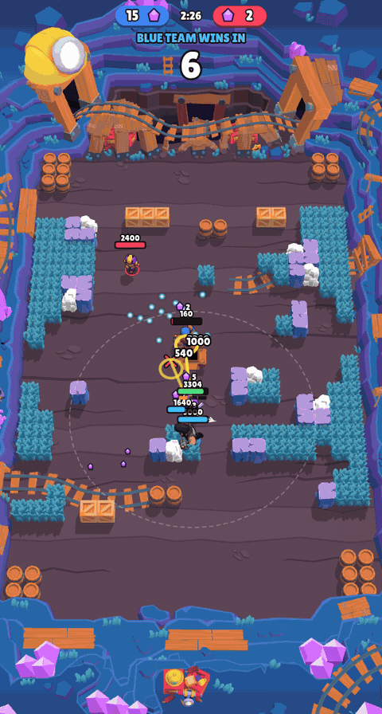
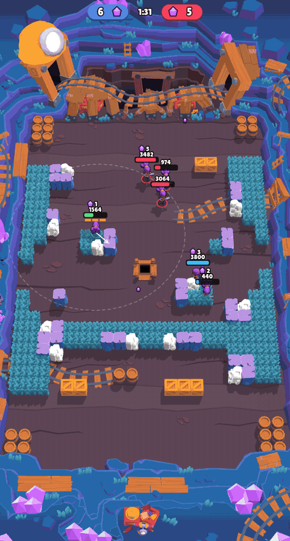

# Brawl Stars Gem Grab agents

Reinforcement-learning agents that play **Gem Grab** in Brawl Stars, trained with PPO against the game's own bots on
the game's *real* logic: the authentic `libg.so` (v36.218) runs headless on a rooted Android tablet, with no
rendering, servers or network, and is stepped tick by tick from our own process at **~30 games per second** (~65k
game ticks/s, over 3,000x real time).



*The final team (blue: Shelly, Colt and Bull, runs/trio_bull2) against three difficulty-4 bots (Bibi, Bea, El Primo),
the last minute of a 25-2 win (eval battle seed 1000053, 1.5x speed).*

A team of three of them (Shelly, Colt and Bull, each with its own network) wins
**37.5%** of battles against three of the game's strongest bots (difficulty 4, random brawlers). A team of three
Shelly agents beats me with two bot teammates, in most battles of a playtest on a phone.

### Me vs agents
I played (blue, with two difficulty-2 bots as teammates) against three Shelly agents (red, runs/shelly30),
1.5x speed:



Full games: [round 1](docs/media/round1.mp4) (0-12), [round 2](docs/media/round2.mp4) (1-14),
[round 3](docs/media/round3.mp4) (5-13). Any saved replay renders the same way: `python3 tools/replay_gif.py
scratch/replays/<replay>.json [--from S --to S] [--mp4]`.

## How it works
- **Headless game** (`harness/jni/driver.c`): an ARM process on the tablet loads the game's logic library, builds
  offline bot battles the way the game's own practice mode does, and calls `executeOneTick` directly. One process
  runs dozens of battles in parallel; 8 processes give ~14-16k decisions/s (one decision = 4 ticks = 0.2 s of game
  time). It also writes the observations (own brawler, allies, enemies, gems, projectiles, a 21x21 tile grid around
  the brawler) and the reward pieces (win, gem difference, damage, kills, ...) for every steered brawler.
- **Environment** (`tools/bsvec.py`, `tools/bsvecenv.py`): a batched binary protocol over adb, gym-like
  `reset/send/recv`; `tools/bsenv.py` is a JSON protocol for play, evals and replays.
- **Training** (`tools/train_ppo.py`, written to be read): PPO on the laptop CPU. We steer all three brawlers of our
  team. Actions are four small menus: move (16 directions or stand), attack (nothing or the game's own auto-aim),
  super (same), gadget. `--team` gives every brawler its own network (each learns only from its own brawler's rows);
  without it one shared network plays all three.
- **Tools**: fixed eval battles and scripted baselines (`tools/eval.py`), exact replays stored as seed + actions
  (`tools/episodes.py`), a training dashboard (`tools/dashboard.py`), a 2D/3D battle viewer (`tools/viewer/`), and
  `tools/play.py` to play against the agents yourself in a browser or on a phone in your home network.

## Results (Gem Grab, map Gemgrab1, 128 eval battles vs difficulty-4 bots with random brawlers)
| model | our team | wins |
|---|---|---|
| runs/team45 (30M decisions, trained vs difficulty 0) | 3 Shelly | 23% (94.5% vs difficulty 0) |
| runs/shelly30 (+28M vs difficulty 2-4) | 3 Shelly | 43.8% |
| runs/shelly30, one shared network | Shelly + Colt + Dynamike | 33.6% |
| runs/trio40, one network per brawler (fine-tuned from shelly30, 40 min) | Shelly + Colt + Dynamike | 31.2% |
| **runs/trio_bull2**, one network per brawler (Bull from shelly30, +48 min) | Shelly + Colt + Bull | **37.5%** |

Dynamike was replaced by Bull: with auto-aim only, his slow throws miss moving targets and he learned to hide.

The full history of runs, what each taught us, and the reward analysis: [docs/training_log.md](docs/training_log.md).

## Reproduce
You need a rooted arm64 Android device (we used a Galaxy Tab S5e), adb, the Android NDK, Python 3 with numpy and
torch (CPU is enough), and **your own copy of the Brawl Stars v36.218 APK**. This repository contains no game files.
1. Put `libg.so`, its libraries and the game's assets on the device in `/data/local/tmp/bsh36/` (layout and offsets:
   [docs/driver_plan.md](docs/driver_plan.md)).
2. Build and push the driver: `sh harness/build_probe.sh && adb push harness/driver /data/local/tmp/bsh36/driver`.
3. Check the environment: `python3 tools/test_vec.py`, `python3 tools/bsvecenv.py --bench`.
4. Train and evaluate:
   ```
   python tools/train_ppo.py --run runs/first --diff 2,3,4,4 --minutes 30
   python tools/train_ppo.py --run runs/trio --team ShotgunGirl=runs/first/last.pt,Gunslinger=runs/first/last.pt,TntDude=runs/first/last.pt \
       --hero ShotgunGirl --mates Gunslinger,TntDude --diff 3,4,4,4 --total-steps 34000000 --minutes 40
   python tools/train_ppo.py --eval runs/trio/last.pt --eval-episodes 128 --diff 4 --hero ShotgunGirl --mates Gunslinger,TntDude
   python3 tools/dashboard.py                       # charts + every eval battle as a replay
   ```
5. Play against them: `python3 tools/play.py --vs runs/trio/last.pt --lan`, open the printed address on a phone.

Internal brawler names: ShotgunGirl = Shelly, Gunslinger = Colt, TntDude = Dynamike (characters.csv).

## Layout
- `harness/jni/driver.c`: the on-device driver (battle setup, tick loop, observations, rewards, actions).
- `tools/`: environment, training, evals, replays, viewer, play server, tests (`test_*.py`); `tools/gfx/` converts
  the game's 3D models and textures from your APK for the viewer (output is not part of the repo);
  `tools/legacy/`: early reverse-engineering scripts, history only.
- `docs/`: [training_log.md](docs/training_log.md) (every run and what it taught us),
  [driver_plan.md](docs/driver_plan.md) (technical log), `01-04_*.md` (early history).

## Ideas for improvements
- **Self-play:** the game's bots stop getting harder at difficulty 4, so the next stronger opponent is our own team.
  Play against earlier checkpoints (a league of past versions) so the agents don't overfit to one opponent.
- **Reward shaping:** the fight rewards (damage, kills) roughly cancel out and pay even in lost battles. Two things to
  try: lower them toward the win and gem rewards, and give every brawler the team's mean damage/kills so that
  covering a teammate pays as much as taking the kill. See [docs/training_log.md](docs/training_log.md).
- **Aimed attacks:** the agents only use the game's auto-aim. Aiming with a lead on moving targets would bring back
  throwers like Dynamike, who learned to hide because his auto-aimed throws miss.
- **Bull:** he deals little damage (~2.2k per minute); check with `tools/policy_stats.py` whether he only carries
  gems.
- **More brawlers, maps and modes:** the driver builds any offline battle (`loc=`, `hero=`, `mates=`), so other Gem
  Grab maps or modes like Brawl Ball need only new evals and training runs.
- **Longer runs:** most runs here were 10-50 minutes on a laptop CPU, where the network update, not the game, is the
  limit (~8.5k of the env's ~16k decisions/s). Hours of training or a GPU are the cheapest next gain to try.

## Legal
Not affiliated with, endorsed or sponsored by Supercell. Brawl Stars and its characters are Supercell's. This
repository ships only our own code and documentation, no APK, libraries or game assets. Everything runs offline
against the game's bots; it is not meant for, and does not connect to, online play.
